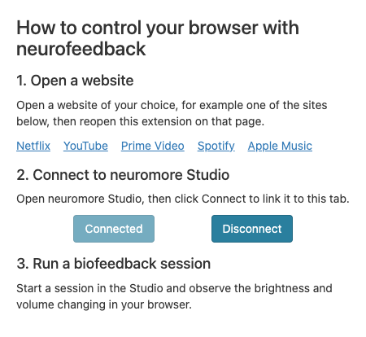
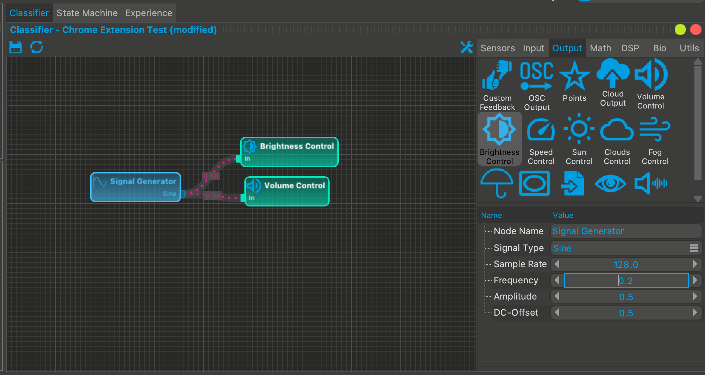
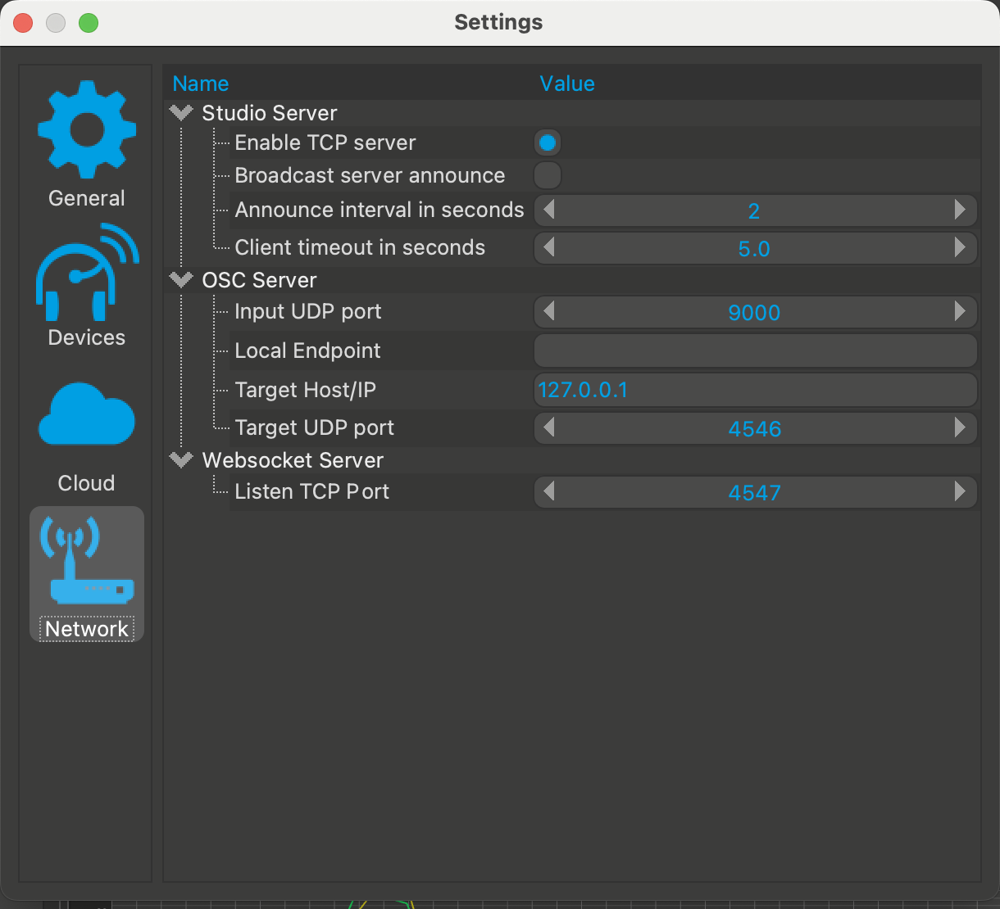

# neuromore Chrome Extension

A Chrome extension that connects a browser tab to [neuromore Studio](https://github.com/neuromore/studio). While a classifier runs in Studio, its output controls the volume and brightness of that tab, so you can do neurofeedback while watching or listening to something in the browser.



## Safety

This extension is not a medical device and makes no medical claims.

Brightness follows the classifier's signal and can change rapidly, up to ten times a second. If you have photosensitive epilepsy or another condition affected by flashing light, take care: use only slowly changing signals, or use only the Volume Control node.

## Requirements

- [neuromore Studio](https://github.com/neuromore/studio/releases) 1.7.0 or newer. Studio asks you to sign in, and a [free community account](https://account.neuromore.com/#/purchase?state=start&productId=community) is enough.
- Chrome or Chromium, with Developer mode enabled to load the extension. The automated tests run on Chromium 156. Other Chromium-based browsers are untested.

You don't need an EEG device to try it. A Signal Generator node in Studio is enough, and [the mock server](#testing-without-hardware) replaces Studio altogether.

## Install

The extension isn't in the Chrome Web Store. Install it by one of these routes.

### From a release

1. Download `neuromore-extension-<version>.zip` from [Releases](https://github.com/neuromore/chrome-plugin/releases).
2. Unzip it into a folder of its own, and keep that folder. Chrome loads the extension from it.
3. Open `chrome://extensions` and turn on **Developer mode**.
4. Click **Load unpacked** and select the folder, which has `manifest.json` directly inside it.
5. Optional: pin the extension from the puzzle-piece menu in the toolbar.

### From source

1. Clone the repository. There is no build step, and you don't need to install anything to use the extension.

   ```sh
   git clone https://github.com/neuromore/chrome-plugin.git
   ```

2. Open `chrome://extensions` and turn on **Developer mode**.
3. Click **Load unpacked** and select the `extension/` folder.

## Usage

1. Start Studio. It starts its WebSocket server on port 4547.
2. Open the website you want to control.
3. With that tab active, click the extension's icon, then click **Connect**. The button changes to **Connected**.
4. If Chrome asks whether the site may access your local network, see [Local network access](#local-network-access).
5. In Studio, open a classifier with a **Volume Control** or **Brightness Control** node. Both are on the Output tab of the node palette.

   To make one for testing, connect a Signal Generator to both nodes. A Sine signal with frequency 0.2, amplitude 0.5 and DC offset 0.5 changes slowly and stays in the useful range.

   

6. Run the classifier. For brightness, 1 is unchanged and 0 is black. For volume, 1 is full and 0 is silent. Values outside 0 to 1 are clamped.
7. To finish, stop the session or click **Disconnect**. The page's original brightness and volume come back. This also happens if Studio closes.

The extension finds nodes by their exact names, `Volume Control` and `Brightness Control`. If you rename a node in Studio, the extension ignores it and shows no error.

Each tab connects on its own. Reloading or leaving a page ends its connection, so reopen the popup and click **Connect** again.

## How it works

When you click **Connect**, the popup injects a content script into the active tab. The content script opens a WebSocket to `ws://127.0.0.1:4547` and applies what Studio sends to the page:

| Direction          | Message                                            | Effect                                                                          |
| ------------------ | -------------------------------------------------- | ------------------------------------------------------------------------------- |
| Extension → Studio | `ON_URL_OPENED`                                    | Tells Studio the tab's URL, once per connection.                                |
| Studio → extension | `ON_FEEDBACK_LAYOUT`                               | Lists the classifier's feedback nodes. Sent on connect and at session start.    |
| Studio → extension | Binary feedback frame                              | One value per node every 100 ms. Sets the volume or brightness.                 |
| Studio → extension | `ON_SESSION_STOPPED`                               | Restores the page.                                                              |
| Studio → extension | `BROWSER_START_PLAYER`, `BROWSER_PAUSE_PLAYER`     | Seeks and plays, or pauses, the page's first `<video>`. Sent by state machines. |
| Studio → extension | `OPEN_URL`                                         | Opens an http or https URL in a new tab. Sent by state machines.                |
| Extension → Studio | `ON_BROWSER_PLAYER_STARTED`, `_PAUSED`, `_STOPPED` | Reports media events on the page.                                               |

The full wire format is in [docs/PROTOCOL.md](docs/PROTOCOL.md).

## Testing without hardware

`tools/mock-studio.js` stands in for Studio. It needs [Node.js](https://nodejs.org) 26, and Studio must be closed because both use port 4547.

```sh
npm ci
npm run mock-studio
```

Connect from a tab with the extension. The site may need [local network access](#local-network-access). The mock runs a session straight away: volume and brightness rise and fall slowly between 0.1 and 0.9. Type a command and press Enter to control it:

| Command           | Effect                                                                        |
| ----------------- | ----------------------------------------------------------------------------- |
| `stop`, `start`   | Stops or starts the session.                                                  |
| `play [fraction]` | Seeks the video to a fraction of its length and plays it. The default is 0.5. |
| `pause`           | Pauses the video.                                                             |
| `url <address>`   | Asks the extension to open a URL.                                             |
| `quit`            | Closes the server.                                                            |

The mock was written from Studio's source code, not from recorded traffic.

## Troubleshooting

### "Could not connect"

- Check that Studio is running.
- In Studio, open **Settings > Network** and check that **Websocket Server > Listen TCP Port** is 4547. If you change it, restart Studio: from reading its source, the port appears to apply only at startup.

  

- If that setting is missing, your Studio is older than 1.7.0.
- Check [local network access](#local-network-access) for the site.

To use a different port, change `WS_URI` at the top of `extension/src/js/websocket.js`, then reload the extension on `chrome://extensions`. The popup's error message in `extension/src/js/control.js` also names the port.

### Local network access

Chrome restricts websites from connecting to addresses on your own machine. The extension's socket runs inside the page, so Chrome treats it as a connection made by that site, and blocks it unless the site has the local network access permission. Adding permissions to the extension's manifest did not change this in our tests on Chromium 156.

If Chrome prompts you, allow it. Otherwise, open the site's settings from the icon to the left of the address bar, allow **Local network access**, then reload the page. The popup can close when you click **Connect**, which may be caused by the prompt taking focus. Answer the prompt and reopen the popup.

This permission lets the site's own scripts reach your local network too, including Studio. Grant it only to sites you trust. See [SECURITY.md](SECURITY.md).

### "Cannot connect on this page"

Chrome doesn't allow extensions on some pages, such as `chrome://` pages and the Chrome Web Store. Open a normal website. This message also appears if the tab moved to another site after you opened the popup: reopen the popup and try again.

### Connected, but nothing changes

- Check that a session is running. Studio sends feedback only during a session.
- Check that the nodes are named exactly `Volume Control` and `Brightness Control`, and that something is connected to their input.
- Restart the session after you edit the classifier. Studio sends the list of nodes only at session start and on connect.
- The audio or video may be out of the extension's reach. See [Known limitations](#known-limitations).

## Permissions

| Permission  | Why it's needed                                                                                               |
| ----------- | ------------------------------------------------------------------------------------------------------------- |
| `activeTab` | Gives the extension temporary access to the current tab when you click its icon, and to no other tab or site. |
| `scripting` | Lets the popup inject the content script into that tab when you click **Connect**.                            |

The extension has no host permissions and no background worker, and it does nothing until you click **Connect**.

## Privacy

The extension sends the tab's URL, and the URLs and playback events of media on the page, to the socket on `127.0.0.1:4547`. It sends nothing to any other address, and has no analytics. Details are in [docs/PRIVACY.md](docs/PRIVACY.md).

## Known limitations

- **Testing.** The automated tests run against the mock server, on local pages and a stand-in for YouTube. They don't cover real Studio or real streaming sites. Whether a given site works depends on its markup.
- **Brightness.** The extension applies a CSS filter to `<body>`, or on YouTube to the video container. A background painted on the page's canvas stays bright while the content dims. The filter may also affect `position: fixed` elements and may not reach fullscreen video.
- **Reach.** It works only in the tab's top frame. Media inside iframes or shadow DOM isn't controlled.
- **Session start.** Studio sends 0 for a node until it has samples, so the page may briefly go black or silent when a session starts.
- **Player control.** Player commands act on the page's first `<video>`, and `BROWSER_STOP_PLAYER` is ignored. The browser may refuse to play or go fullscreen without a user gesture. Studio's Start Browser Player action defaults to progress 1.0, which seeks to the end of the video.
- **Opening URLs.** Chrome's popup blocker may stop `OPEN_URL`. Schemes other than http and https are ignored.
- **Several tabs.** Each connected tab has its own socket and Studio broadcasts to all of them, so one `OPEN_URL` or player command acts once per connected tab.
- **Unresponsive Studio.** There is no heartbeat. If Studio hangs but keeps its socket open, the page stays at its last level until you click **Disconnect**.
- **URL changes.** The URL is sent once per connection, so navigation inside a single-page app isn't reported to Studio.

## Contributing

See [CONTRIBUTING.md](CONTRIBUTING.md) and the [Code of Conduct](CODE_OF_CONDUCT.md). Report vulnerabilities as described in [SECURITY.md](SECURITY.md). Changes are listed in [CHANGELOG.md](CHANGELOG.md).

## License

Apache License 2.0. See [LICENSE](LICENSE) and [NOTICE](NOTICE). neuromore Studio is a separate project with its own license.

Netflix, YouTube, Prime Video, Spotify and Apple Music are trademarks of their owners. This project isn't affiliated with or endorsed by them.

## Acknowledgements

Original author: Julius Rudolph.
